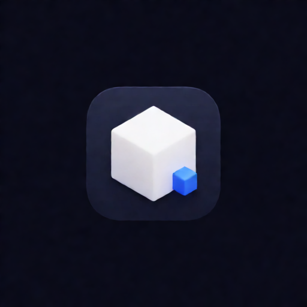

# dsh-unity-mcp



把 [CoderGamester/mcp-unity](https://github.com/CoderGamester/mcp-unity) 的 Unity / 团结引擎编辑器工具接入 DSH，默认按 Agent 懒加载。

**必须先在 Unity 或 Tuanjie（团结引擎）项目中安装 CoderGamester 的 MCP Unity Server，并启动引擎端服务。只安装本 npm 插件无法控制编辑器。** 本项目是 DSH 适配插件；引擎端与实际编辑器工具由上游提供。上游项目、安装说明及许可证见 [CoderGamester/mcp-unity](https://github.com/CoderGamester/mcp-unity)。

## 安装与连接

需要 Node.js 22+、DSH `>=0.2.1-rc.3 <0.3.0`。上游当前声明 Unity 2022.3+；Tuanjie 的兼容性取决于所用引擎版本和上游包，不能保证所有版本都适用。

1. 在 Unity / Tuanjie 的 Package Manager 中选择 **Add package from git URL**，填入：
   ```text
   https://github.com/CoderGamester/mcp-unity.git
   ```
2. 打开 **Tools → MCP Unity → Server Window**，按照上游说明启动服务。找到该项目安装的 `Server~/build/index.js`。如果没有构建文件，在对应的 `Server~` 目录运行 `npm install` 和 `npm run build`。DSH 插件不会自动下载、安装或构建引擎包。
3. 在 DSH 插件管理中安装 npm 包：
   ```text
   dsh-unity-mcp
   ```
4. 在插件配置中设置 `projectPath` 为引擎项目绝对路径。插件会查找 `Packages/com.gamelovers.mcp-unity/Server~/build/index.js` 以及 `Library/PackageCache` 中的构建文件，也兼容 `com.codergamester.mcp-unity` 目录名。存在多个缓存版本时，必须明确设置 `serverPath`。
5. 找不到构建文件时，把 `serverPath` 设置为引擎 Server Window 给出的服务器入口绝对路径。可以使用单独克隆并构建的上游服务器；此时仍建议填写 `projectPath`，以读取正确的项目端口和认证设置。

配置示例（请替换路径）：

```json
{
  "projectPath": "C:/Projects/MyUnityProject",
  "serverPath": "C:/Tools/mcp-unity/Server~/build/index.js",
  "lazyTools": true
}
```

配置为空时插件仅提供加载入口，并提示如何连接。它不会启动 Unity / Tuanjie 编辑器。连接配置完成后，DSH 启动上游 Node stdio 桥接进程，由桥接进程连接引擎端服务。

## 通过对话配置工程（0.0.2 起）

可以直接告诉 Agent：“把 Unity MCP 连接到 `C:/Projects/MyUnityProject`。”Agent 先调用 `unity_load_tools`，再调用 `unity_configure_project`，传入工程绝对路径 `projectPath`；只有自动发现失败时才需要补充 `serverPath`。未连接引擎时也能加载配置工具。

工具检查工程的 `Assets`、`ProjectSettings` 和已构建的 CoderGamester 服务器入口，再通过 DSH 官方配置服务保存并重载插件。**保存影响当前 profile 的所有会话；会清空旧的 host、port、authTokenPath 覆盖项，改用新工程设置。** 其他配置保留。路径校验失败不会保存；并发修改连接字段时会要求重试。保存成功仅表示配置已应用，仍需重新加载工具并做只读场景查询，确认引擎在线。

工具不会安装引擎包、构建服务器或启动编辑器。也可以继续在插件配置中手工设置路径。

## 工具懒加载

每个 Agent 初始只看到 `unity_load_tools`。调用后先获得 `unity_configure_project`，并加载当前服务器提供的 `mcp__unity__*` 工具；未连接时只有配置工具。其他 Agent 仍保持未加载。场景、GameObject、组件、材质、资源、控制台和测试等工具的参数与结果沿用上游，插件不维护另一套工具清单。

加载动作不会修改工程。**加载后的编辑器操作可能创建、删除资源，修改场景、执行菜单或安装包。请先提交或备份工程，并检查每次调用的范围。** 如需立即暴露全部工具，把 `lazyTools` 设为 `false`。实际工具数量随上游版本变化。

插件在每个 Agent 步骤前同步工具列表；服务器重新注册或移除工具后，会更新已加载 Agent 的可见工具。插件卸载时清理所属加载入口、局部工具与限制。

## 配置

| 字段 | 默认值 | 用途 |
| --- | --- | --- |
| `projectPath` | 空 | Unity / Tuanjie 项目绝对路径；用于发现服务器与读取项目设置 |
| `serverPath` | 空 | 已构建的上游服务器 JS 入口绝对路径；优先于自动发现 |
| `lazyTools` | `true` | 按 Agent 加载编辑器工具 |
| `host` | 空 | 覆盖 `UNITY_HOST`；留空沿用上游设置 |
| `port` | `0` | 覆盖 `UNITY_PORT`；0 沿用项目设置 |
| `authTokenPath` | 空 | 可选 token 文件绝对路径，配置中不保存 token 内容 |
| `toolCallTimeoutMs` | `120000` | 单次 MCP 工具超时，范围 1000–600000 毫秒 |

填写 `projectPath` 后，桥接进程使用项目的 `ProjectSettings/McpUnitySettings.json`。认证方式由上游控制；不要把 token 提交到 Git。更换项目时同步修改项目路径、服务器入口及端口，避免连接错误的编辑器。已有其他 Unity MCP 连接时，应避免重复注册相同 `unity` 命名空间。

## 排障

- **Built CoderGamester server not found**：确认引擎包已经安装并构建，或者手动填写 `serverPath`。
- **Multiple cached CoderGamester servers found**：缓存中存在多个构建版本，明确选择 `serverPath`。
- **Unity MCP is not connected**：检查插件配置、DSH MCP 日志，以及引擎 Server Window 中的运行状态、端口和认证设置。
- **工具已加载但调用失败**：加载工具清单不等于引擎在线。确认项目仍然打开、服务仍在运行。

## 开发

```sh
npm install
npm test
npm run build
npm run pack:check
```

测试覆盖服务器发现、配置边界、Agent 隔离、延迟发现、工具更新与清理。测试中的上下文大小比较使用 UTF-8 schema 字节数，不把字节数当作模型 token 数。

## 来源与许可

本适配插件采用 MIT 许可证。实际 Unity MCP 服务来自 **CoderGamester/mcp-unity**，上游采用 MIT 许可证。本插件不打包上游引擎或服务器源码，也不代表 Unity Technologies、团结引擎或 CoderGamester 官方产品。请遵守上游安装要求及许可。

图标由 Krea 2 Turbo 生成，是本插件的独立图案，不使用 Unity 官方标志。相关说明见 [THIRD_PARTY_NOTICES.md](THIRD_PARTY_NOTICES.md)。
